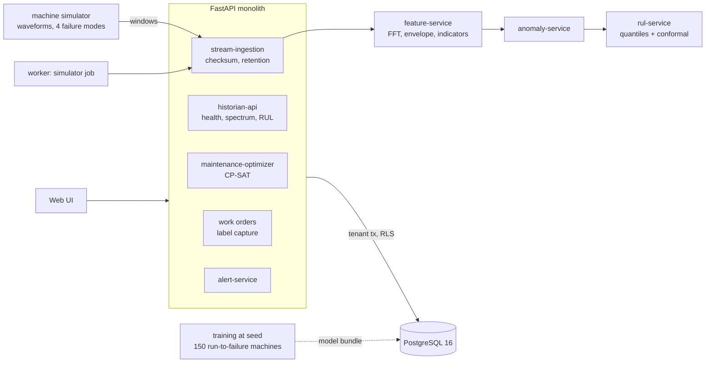

# Industrial Predictive Maintenance & Remaining Useful Life Platform

Condition monitoring for rotating machines: turn vibration waveforms into spectral features, notice when a machine leaves its own
healthy range, name the likely failure mode, predict how many hours it has left with an honest uncertainty band, and schedule the
repair where it costs least. What the technician finds comes back as a training label.

Built from blueprint 6 of an "Enterprise SaaS + AI" build book as a **vertical slice**: the demo scenario end to end, with the
platform parts real and the rest listed under [Not built](#not-built-and-why).

**The machines, their vibration and their failures are simulated. No real equipment data is used.**

## Run it

```bash
docker compose up --build        # migrates, trains on a simulated fleet, seeds a plant (about 40 s), serves http://localhost:8106/ui/
docker compose run --rm test     # 22 tests against a throwaway database
```

Open http://localhost:8106/ui/ and press **Run all steps**, or `make bootstrap demo`. API docs at `/docs`.
Demo tokens (local only): `acme-technician-demo`, `acme-planner-demo`, `acme-admin-demo`.

## The demo, step by step

1. The plant runs for 20 simulated days. Twelve machines send half a second of vibration every six hours: 960 windows, 3.9 million samples, each featured and scored on arrival. Three alerts open.
2. On the conveyor motor, the envelope spectrum shows a line at the bearing's outer-race defect frequency (98.3 Hz) 47 times higher than when healthy, while overall vibration has not even doubled. The health score is 46 against an alarm level of 4.8.
3. Remaining life: 268 hours (80% band 230 to 391). The simulator's true value is 240.
4. Left alone it has an 86% chance of failing within 14 days; an unplanned failure costs $77,850, an expected loss of $67,029, against $2,700 for a planned repair while the line is stopped.
5. The solver puts the motor and a pump into a planned changeover on day 6 and sends the fan, which cannot wait, to an early shift on day 2. Expected cost $13,788, against $40,067 for fixing everything at the first opening and $111,631 for running to failure.
6. The bearing is replaced; the technician confirms outer-race damage, which is stored as a label. Three days later the health score is 1.9.

## Architecture



| Piece | How it works |
|---|---|
| Features | Detrend, Hann window, FFT; RMS, peak, crest factor, kurtosis, band energies, amplitude at 1x and 2x shaft speed; band-pass and Hilbert envelope, then the envelope spectrum at the bearing defect frequencies. |
| Relative to baseline | Every indicator is divided by the machine's own median over its first ten windows after installation or overhaul. A sensor with seven times the gain gives identical inputs (tested). |
| Anomaly | Mahalanobis distance of five relative indicators from the healthy cloud; alarm after two consecutive windows above a threshold set for a 0.5% false-alarm rate. |
| RUL | Gradient-boosted quantile regression (10th, 50th, 90th percentile) on levels, trends and age; the band is adjusted by conformal calibration on machines held out from training. |
| Failure mode | Gradient-boosted classifier over the same inputs. |
| Scheduling | RUL quantiles become a log-normal failure probability; an exact solver chooses a slot per machine to minimise failure risk + planned cost + life thrown away, under technician capacity and part lead times. |
| Retention | Raw waveforms are kept for the healthy reference windows and the latest 40 per sensor; older ones are dropped, their features stay. |
| Platform | Row-level security per tenant, Postgres job queue, idempotent window ingest, hash-chained audit log, `/metrics`. |

## Data model

`migrations/002_maintenance.sql` follows the blueprint (sites, assets, sensors, signal_windows, features, anomaly_scores,
rul_predictions, maintenance_windows, work_orders, model_labels); additions are marked `(+)`.

## API

| Method | Endpoint | Purpose |
|---|---|---|
| POST | `/v1/signals:batch` | Upload waveform windows; features, score and RUL update in the same transaction |
| GET | `/v1/assets/{id}/health` | Current health score, history, alerts |
| GET | `/v1/assets/{id}/spectrum` | Envelope and raw spectrum, latest window against the healthy reference |
| GET | `/v1/assets/{id}/rul` | RUL distribution, evidence, cost of doing nothing |
| POST | `/v1/maintenance:optimize` | Schedule across the fleet, compared with two simple policies |
| POST | `/v1/alerts/{id}:ack` | Acknowledge an alert |
| POST | `/v1/work-orders` · `/v1/work-orders/{id}:complete` | Create · complete with findings (becomes a label; the asset starts a new baseline) |
| POST | `/v1/simulator:run` | (+) Job that advances the simulated plant through ingestion |

Contract: [`docs/openapi.json`](docs/openapi.json).

## Measured

[`docs/evaluation.md`](docs/evaluation.md) (`python -m pm.evaluate`) and [`docs/performance.md`](docs/performance.md). 30 machines held out.

| Component | Result | Baseline |
|---|---|---|
| Remaining life, last 300 hours | 23.0 h mean error | fleet average life minus age: 180.7 h |
| 80% band | holds 80.7% after calibration (75.5% before) | |
| Warning before failure, same false-alarm rate | 773 h median, every machine caught | RMS level alarm: 535 h; isolation forest: 167 h, 12 of 30 never alarmed |
| Failure mode, last 40% of life | 100% of windows | 25% by guessing |
| Maintenance plan in the demo | $13,788 expected | fix at first opening $40,067; run to failure $111,631 |

The mode classifier is perfect because the four simulated modes leave cleanly separate fingerprints. Real faults overlap; expect far less.

## The hardest tradeoff

Which anomaly detector. The blueprint names an isolation forest as the baseline, so that was built first, and it nearly shipped: on
a clean simulator it looked fine. Once load variation was added it missed 12 of 30 failing machines. The reason is structural: an
isolation forest scores a point by how quickly random splits isolate it, and a point far outside the healthy cloud is isolated about
as quickly as one just outside it. The score saturates, so a badly worn machine does not score higher than an odd healthy window, and
a threshold tight enough for a low false-alarm rate is never crossed. A plain distance from the machine's own healthy baseline grows
with the wear and warned a median 773 hours ahead. The forest is kept in the evaluation as a baseline that lost. The cost of the
distance approach is that it assumes the healthy cloud is roughly elliptical and needs a clean baseline period after every overhaul.

## Threat model (summary)

| Threat | Mitigation here | Gap |
|---|---|---|
| Forged or corrupted sensor data | Windows must be the right length, finite and within range; stored by checksum; the sensor must belong to the caller's tenant | No device identity or signing (the blueprint's edge agent is not built) |
| One customer's plant visible to another | Sites carry the tenant under row-level security; every asset, alert and work order is reached through its site (tested) | |
| A bad model quietly driving maintenance | Predictions carry the model version; the evaluation and baselines are stored in the registry; technician findings are captured as labels, including false alarms | Labels are not yet used to retrain; no drift monitor |
| Disputed maintenance decisions | Plans, acknowledgements and work orders are audited with solver and model versions in a hash chain | No external anchor |

## Not built, and why

- **Real data** (for example NASA's C-MAPSS) and real machines: everything is simulated; the simulator's fingerprints are cleaner than life.
- **Edge agent, MQTT/Kafka ingestion, a time-series or object store**: windows arrive by HTTP or from the simulator job; waveforms sit in a Postgres table.
- **Wavelets, autoencoders, sequence models, survival analysis**: FFT and envelope features with gradient boosting were enough here.
- **Technician rosters and spare-part inventory**: capacity is a number per slot and a lead time per part.
- **Retraining from labels, incremental scoring, load test at thousands of sensors**: not started.
- **Kafka, Redis, OpenTelemetry, Grafana, Terraform, CI, SSO, a Next.js front end**: not needed to prove the slice; no cloud account used.

## Commercial sketch

Buyer: manufacturers, utilities, warehouse automation. Pricing shape from the blueprint: per monitored asset or sensor channel, with
the RUL module and historian connectors as upgrades. The UI's "What is it worth?" panel multiplies the plan's saving over the two
simple policies by an assumed number of such situations a year.

## Layout

```
core/        platform kit: db + RLS, jobs, audit chain, HTTP, scenario runner, load test
pm/          sim (waveforms), dsp (features), models (anomaly, mode, RUL), optimize (schedule), store (ingest, score, retention), api, seed, evaluate
migrations/  forward-only SQL          web/   UI, scenario.json, demo.json (recorded run)
tests/       22 tests                  docs/  evaluation.md, performance.md, openapi.json
```
